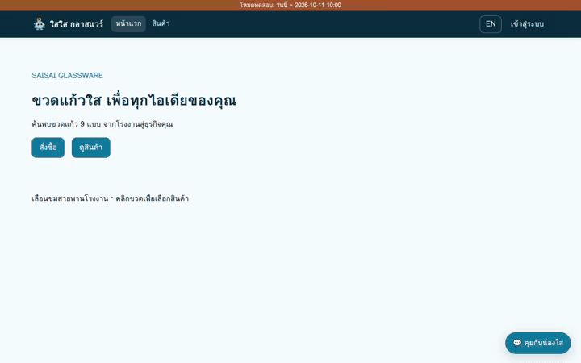
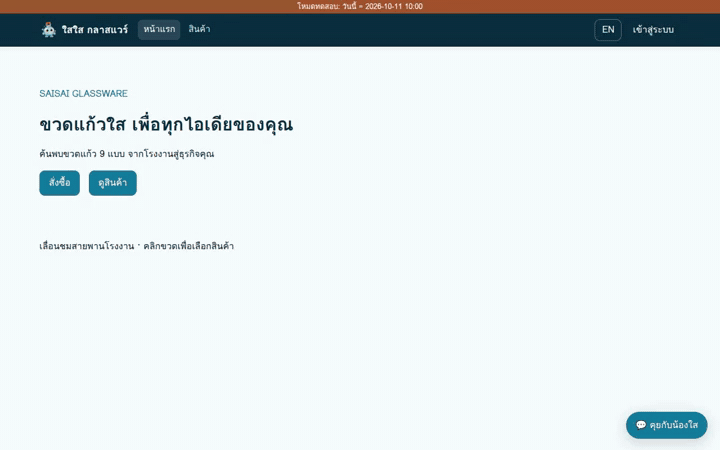
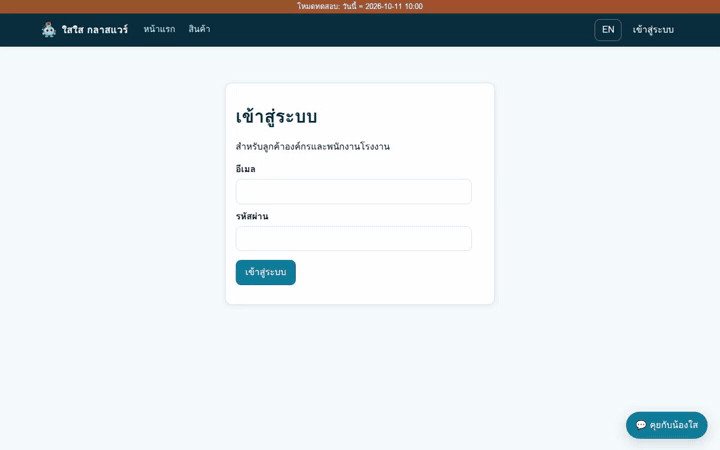

# เอกสารส่งงาน: ระบบเว็บโรงงานขวดแก้ว B2B "ใสใส กลาสแวร์" (SaiSai Glassware v3)

---

## 1. ระบบทำอะไร

ระบบเว็บแอปพลิเคชันสั่งซื้อขวดแก้ว B2B แบบครบวงจรสำหรับ **บจก. ใสใส กลาสแวร์ (SaiSai Glassware Co., Ltd.)** พัฒนาขึ้นใหม่ทั้งหมด (Greenfield) รองรับ 2 ภาษา (ไทย/อังกฤษ) และแยกสิทธิ์ข้อมูลรายบริษัทอย่างเคร่งครัด (`customer`, `staff`, `owner`) ประกอบด้วย:
- **หน้าร้านและระบบสั่งซื้อ B2B (`/`, `/products`, `/order`, `/orders`, `/claims`, `/samples`)**: แสดงขวดแก้ว 9 แบบ (4 รุ่น: `B-100`, `B-150`, `B-250`, `B-500` · 3 สี: ใส, ชา, เขียว) คำนวณราคาค่าขวด ส่วนลดตามขั้นบันไดและช่วงวันที่ (ก่อน/ตั้งแต่ `2026-11-01`) ค่าพิมพ์โลโก้ (`฿0.80`/ใบ เมื่อสั่ง ≥ 5,000 ใบ) ค่าขนส่งตามระยะทางและจำนวนเที่ยวรถ (`20,000` ใบ/เที่ยว · ≤ 50 กม. ฟรี · > 300 กม. ติดต่อเซลส์) วันรับของเร็วสุด (≥ 14 วัน ข้ามวันหยุดโรงงาน) เงื่อนไขการชำระเงิน (Prepay / เครดิต 30 วันเมื่อส่งครบ 3 ออเดอร์) แจ้งเตือนเมื่อสั่งเพิ่มถึงขั้นส่วนลดแล้วถูกกว่า (Upsell) ระบบขอขวดตัวอย่างฟรี (≤ 3 ใบ/รุ่น/เดือน) และระบบแจ้งเคลมสินค้าภายใน 7 วัน
- **ระบบใบเสนอราคา (`/quotes`, `/quotes/[no]`)**: ออกเอกสารใบเสนอราคา (`QT-NNNN`) จากหน้าเว็บหรือจากแชทบอท บันทึก Snapshot ตารางราคา ณ วันออก (อายุ 7 วัน) รองรับการพิมพ์ (Print CSS) และกดแปลงเป็นใบสั่งซื้อ (`SO-NNNN`) ได้โดยตรวจสอบกฎธุรกิจซ้ำทั้งหมด
- **ระบบหลังร้านและแจ้งเตือนสด (`/staff/*`, `/owner/holidays`, `/admin/*`)**: จัดการสถานะออเดอร์ 6 ขั้น บันทึกรับเงิน พิจารณาเคลม จัดการวันหยุดโรงงาน จัดการเอกสาร PDF (`/admin/docs`) ดูผลประเมิน RAG (`/admin/eval`) และดูผลทดสอบการรับโหลด (`/admin/load`) พร้อมกล่องแจ้งเตือนสด (`notify-box`) ผ่าน RabbitMQ
- **แชทบอท AI "น้องใส" ฟังและพูดได้ + มาสคอต 3D**: ตอบคำถามสินค้า คำนวณราคา ออกใบเสนอราคา และเช็กสถานะออเดอร์จากฐานข้อมูลและ `rules.ts` (`[PRICE]`, `[QUOTE]`, `[ORDER_STATUS]`) ผสานการค้นเอกสารคู่มือด้วย Hybrid RAG + Reranker พร้อมป้ายอ้างอิงคลิกเปิดหน้า PDF (`chat-cite`) รองรับการถามด้วยเสียงผ่านไมโครโฟน (Whisper STT) และอ่านคำตอบออกเสียงอัตโนมัติทีละประโยค (VoxCPM2 TTS) พร้อมมาสคอต 3D ขยับท่าทางและขยับปากตามเสียงพูดจริง

---

## 2. สถาปัตยกรรม (Architecture)

```text
Browser (Next.js :3600 + Three.js + WebAudio)
  │
  ├── POST /api/chat (SSE) ──► RabbitMQ [chat.request] ──► chat-worker (×N)
  │                              ▲ (priority 5 · DLQ)        ├─► PostgreSQL 16 + pgvector + pg_trgm
  │                              └─◄ [chat.reply] ───────────┤─► web/lib/rules.ts quote() (ห้ามแก้ตรรกะ)
  │                                                          ├─► GPU-3 /v1/rerank (bge-reranker-v2-m3: top 20 → top 4)
  │                                                          ├─► GPU-1 LLM (Qwen บน RTX 5090 / mock-llm)
  │                                                          └─► ส่งประโยคที่จบ ──► [tts.request]
  │
  ├── 🔊 เล่นเสียงตาม seq ◄── [tts.request] ──► tts-worker (×N) ──► GPU-3 TTS (VoxCPM2 บน RTX 4090)
  ├── 🎙 POST /api/voice  ──► [stt.request] ──► stt-worker (×N) ──► GPU-2 STT (Faster-Whisper บน RTX 4090)
  ├── 📄 อัปโหลดเอกสาร   ──► [rag.ingest]  ──► rag-worker      ──► embedder (Multilingual CPU) ──► doc_chunks
  └── 🔔 ออเดอร์/เคลม/QT  ──► [order.events] (fanout) ──────────► notify-worker ──► notifications
```

- **RabbitMQ (Queue & Backpressure)**:
  - แยก 1 คิวต่อ 1 GPU (`chat.request` → GPU-1, `stt.request` → GPU-2, `tts.request` → GPU-3) และ `rag.ingest` สำหรับแปลง PDF รวมถึง `order.events` (Fanout Exchange) สำหรับแจ้งเตือนหลังร้าน
  - กำหนด `prefetch` ตามความจุ GPU ต่อ worker (`CHAT_PREFETCH=4`, `STT_PREFETCH=4`, `TTS_PREFETCH=2`) รองรับการขยายด้วย Competing Consumers (`--scale`)
  - มีระบบจัดลำดับความสำคัญ (`x-max-priority: 5` ให้โหมดเสียงได้ลำดับก่อน) ระบบพักข้อความที่ไม่หายพร้อม Dead-Letter Queue (`chat.dlq` เมื่อล้มเหลว > 2 ครั้ง) และระบบ Backpressure แจ้งลำดับคิว/ลดการสร้างเสียง/ตัด 429 เมื่อคิวหนาแน่นเกินเกณฑ์
- **Hybrid RAG + Reranker**:
  - แยกแหล่งข้อมูลชัดเจน: ราคา/ส่วนลด/ยอดเงิน/ออเดอร์ ดึงจาก PostgreSQL + คำนวณด้วย `web/lib/rules.ts` (`quote()` ชุดเดียวกับหน้าเว็บ) เท่านั้น ส่วนความรู้ผลิตภัณฑ์และนโยบายดึงจาก PDF 7 เล่ม
  - แบ่งเอกสารเป็น Chunk ขนาด ~500 ตัวอักษร (ซ้อนทับ 80 ตัวอักษร) โดยตรึงชื่อตารางและหัวคอลัมน์ทุกชั้น/หัวแถวไว้ในทุก Chunk ของตาราง
  - ค้นหาแบบผสม (Hybrid Search): รวมผลจาก Vector Search (`pgvector` cosine similarity หลายภาษา) และ Keyword Search (`pg_trgm` จับรหัสเฉพาะ เช่น `B-250`, `LOT-`, `P07`) ด้วย Reciprocal Rank Fusion (`RRF = Σ 1/(60+rank)`) คัด Top 20 ส่งให้ `bge-reranker-v2-m3` จัดอันดับเหลือ Top 4 (หากปิด Reranker หรือช้าเกิน 3 วินาที จะสลับใช้ Top 4 จาก RRF อัตโนมัติโดยแชทไม่ล่ม)
- **STT / TTS (Pipeline ขนานรายประโยค)**:
  - **STT (ฟังเสียง)**: รับเสียงจากไมโครโฟน (`audio/webm;codecs=opus` ≤ 30 วินาที) ส่งผ่าน `stt.request` ไปยัง Faster-Whisper (`large-v3` / `large-v3-turbo`) พร้อม `initial_prompt` คำศัพท์เฉพาะของร้าน
  - **TTS (พูดตอบ)**: ทันทีที่ LLM สตรีมคำตอบจบแต่ละประโยค `chat-worker` จะส่ง `tts.request` ทันทีโดยไม่รอจบทั้งข้อความ ให้ `tts-worker` เรียก VoxCPM2 (โคลนเสียง `nongsai` ไทย/อังกฤษ) แปลงสัญลักษณ์เงินและรหัสเป็นคำอ่าน (เช่น `฿5.80` → "ห้าบาทแปดสิบสตางค์", `B-250` → "บี สองร้อยห้าสิบ") แคชไฟล์ WAV ด้วย `sha256(ข้อความ+ภาษา)` และส่งให้เบราว์เซอร์เรียงเล่นตาม `seq`
- **เว็บ 3D และมาสคอต 3D (`react-three-fiber` + `drei`)**:
  - หน้าแรกแสดงขวดแก้ว 9 แบบลอยหมุนด้วยวัสดุโปร่งแสง (`MeshTransmissionMaterial`) สีตรงรุ่น เลื่อนหน้าจอเพื่อเคลื่อนกล้องตามสายพานโรงงาน และคลิกขวดเพื่อไปหน้าสั่งซื้อรุ่น/สีนั้นได้ทันที พร้อมหมุนดูขวด 3D ในการ์ดหน้า `/products` (จำกัด `dpr ≤ 2`, หยุดเรนเดอร์เมื่อพ้นจอ/สลับแท็บ, รองรับ `prefers-reduced-motion`)
  - มาสคอต 3D **"น้องใส"** (`data-testid="mascot"`) มี 4 สถานะ (`idle`, `listening`, `thinking`, `talking`) ขยับปากตามความดังเสียงจริงผ่าน WebAudio `AnalyserNode` (RMS → `data-mouth` 0.00–1.00 อัปเดต ≥ 10 ครั้ง/วินาที) และมี Fallback เป็นภาพ 2D อัตโนมัติเมื่อเบราว์เซอร์ไม่มี WebGL

---

## 3. ข้อมูล (PDF 7 เล่ม 122 หน้า · คำถาม 770 ข้อ ตรวจด้วย Qwen + Canary)

- **เอกสาร PDF ต้นฉบับ (`docs/pdf/` · สร้างจาก `data/facts/*.json` ตรวจด้วย `tools/verify_pdfs.py` ผ่านครบ)**:
  รวม **7 เล่ม 122 หน้า A4** (ไม่มีราคาขวดใน PDF เพื่อแยกทดสอบ SQL/`quote()` อย่างชัดเจน) มีโครงสร้างตารางซับซ้อน (ตารางหัว 2–3 ชั้น, เซลล์รวม, ตารางข้ามหน้า, เชิงอรรถ, ข้ามภาษา TH/EN):
  1. `SS-CAT-BOTTLES.pdf` (24 หน้า): แคตตาล็อกและสเปกขวด 9 แบบ (`P01–P09`), มิติ/น้ำหนัก/ปากขวด, ตารางเมทริกซ์รุ่น × สี และเชิงอรรถ
  2. `SS-LOGO-PRINT.pdf` (18 หน้า): วิธีพิมพ์โลโก้, ตารางพื้นที่พิมพ์หัว 2 ชั้น, ขั้นต่ำ 5,000 ใบ, ขั้นตอนอนุมัติแบบในขั้นยืนยันสเปก
  3. `SS-QC-STANDARD.pdf` (20 หน้า): มาตรฐานการผลิตและ QC, โครงสร้างเลขล็อต `LOT-` + 6 หลัก, ตารางชนิดตำหนิ (เซลล์รวม), การทนความร้อน 42 °C
  4. `SS-USE-CARE.pdf` (18 หน้า): การใช้งานตามกลุ่มอุตสาหกรรม, การล้าง/บรรจุร้อน ≤ 85 °C (อุ่นขวด ≥ 45 °C), ตารางแนะนำรุ่น × ผลิตภัณฑ์
  5. `SS-POLICY.pdf` (16 หน้า): นโยบายการขาย 6 ขั้น, วันรับของ 14 วัน + วันหยุดโรงงาน, เครดิต 30 วัน, ใบเสนอราคาอายุ 7 วัน, ตัวอย่างฟรี, เงื่อนไขเคลม 7 วัน
  6. `SS-LOGISTICS.pdf` (14 หน้า): การบรรจุและขนส่ง, ตารางขวดต่อกล่อง/พาเลท (เช่น B-500 กล่องละ 24 ใบ), รถ 1 เที่ยว = 20,000 ใบ, เขตส่งฟรี ≤ 50 กม.
  7. `SS-FAQ-EN.pdf` (12 หน้า): คู่มือและคำถามที่พบบ่อยภาษาอังกฤษ (MOQ, Lead Time 14 Days, Free Samples, Claims)
- **ชุดคำถามประเมิน RAG (`gemini/rag-questions/*.jsonl`) และการตรวจสอบคุณภาพ (`qwen/`)**:
  - จำนวนคำถามรวม **770 ข้อ** (เล่มละ **110 ข้อ** × 7 เล่ม) ผ่านสคริปต์ตรวจโครงสร้าง `gemini/check_questions.py` ครบทุกเกณฑ์ (สัดส่วน `direct` ~40%, `paraphrase` ~25%, `table` ~15%, `crosspage/footnote` ~10%, `unanswerable` ~10% เล่มละ 11 ข้อ ≥ 6 หัวข้อ และมีคำถามภาษาอังกฤษ ≥ 7 ข้อต่อเล่ม)
  - **ตรวจทานอิสระด้วย Qwen (`qwen/review_questions.py`)**: ตรวจสอบคำถามและคำตอบอ้างอิงเทียบกับข้อเท็จจริง (`fact_ids`) ทุกข้อ ผลลัพธ์ผ่าน **770 / 770 ข้อ (100%)**
  - **ทดสอบดักจับข้อผิดพลาดด้วยชุด Canary (`--canary` + `--strict-tokens`)**: สุ่มคำถาม **30 ข้อ** มาดัดแปลงให้ผิดโดยตั้งใจ (ตัวเลข 7 · รหัสรุ่น 7 · สี 6 · แปลงเป็น `unanswerable` 10) ผล: **Qwen อย่างเดียวจับได้ 27 / 30 (90.0% · เกณฑ์ ≥ 90%)** (`qwen/review-canary/`) · ด่าน strict-tokens (ใช้กฎ ไม่เรียกโมเดล) จับได้ 20 / 20 ข้อที่ใช้กฎได้ (`qwen/review-strict/canary.jsonl`) · **รวมสองด่าน 30 / 30 (คำนวณ)** · strict บนข้อจริง 693 / 693 ผ่าน (`qwen/review-strict/real.jsonl`)

---

## 4. ตาราง "รองรับพร้อมกันได้กี่คน" (Load Test Capacity)

เกณฑ์ผ่านต่อขั้น (`loadtest/criteria.json`): **Delay `p95 ≤ 12 วินาที` และ `Error < 1%`** · เป้า 200 คน · โหมดหลัก `mix` = แชท 70% + เสียง 30% · `think-sec = 30` · stage 120 วิ · กราฟ: `report/latency_vs_users.png`
ที่มาทุกตัวเลข: `orchestra/app/loadtest/results/<ไฟล์>.json` (ระบุในคอลัมน์สุดท้าย)

| โหมดการทดสอบ | รายละเอียดการตั้งค่า | รองรับสูงสุด `N` | p95 ที่ขั้น `N` | Error ที่ขั้น `N` | คอขวด / จุดพังเมื่อเกิน | ค่าเช่า GPU/ชม. | ไฟล์ |
|---|---|---:|---:|---:|---|---:|---|
| **`mock` ปิด cache ทุกชั้น** *(ตัวเลขหลัก)* | `MODE=mock` · retrieval cache + TTS cache ปิด · prefetch `4/4/2` · คำถามไม่ซ้ำจาก 770 · chat-worker ×2 | **15** | 5.33 วิ | 0.00% | 20 คน: error 1.27% · p95 22.61 วิ (`MISSING_TTS` 1 ครั้ง) | $0.00 | `T22-mock-cold-tts.json` |
| **`mock-nocache`** *(retrieval cache ปิด · TTS cache ยังเปิด)* | `MODE=mock` · prefetch `4/4/2` · คำถามไม่ซ้ำ · หลังแก้ trigram | 25 | 8.26 วิ | 0.00% | 50 คน: error 3.90% · p95 13.50 วิ (คิว chat เต็ม) | $0.00 | `mock-mix-nocache-pruned.json` |
| **`mock-cache`** *(เสริม)* | `MODE=mock` · เปิด cache · คำถามซ้ำ · prefetch `48/16/32` · ผ่านครบ 1→250 | 250 (ยังไม่วัดเกิน) | 7.10 วิ | 0.00% | ไม่พบจุดพังในช่วงที่วัด · ไม่ใช่ความสามารถของโมเดลจริง | $0.00 | `mock-mix.json` |
| **`GPU baseline`** (mix) | `MODE=ai` · 3 GPU (5090 Qwen + 4090 Whisper + 4090 VoxCPM2+rerank) · worker `1/1/1` · prefetch `4/4/2` · ปิด cache ทุกชั้น | **0** (1 คนยังไม่ผ่าน) | 25.90 วิ ที่ 1 คน | 25.00% ที่ 1 คน | TTS บน GPU ใบเดียว (VoxCPM2 ทำทีละงาน) | **$1.35815** | `gpu-mix-scale-base-nocache-r2.json` |
| ↳ GPU chat | 5090 Qwen | **16** | 10.06 วิ | 0.00% | 32 คน: p95 23.11 วิ | $0.53037 | `gpu-chat-nocache.json` |
| ↳ GPU stt | 4090 Whisper large-v3 | **16** | 10.09 วิ | 0.00% | 32 คน: error 20.39% | $0.41389 | `gpu-stt-nocache-r2.json` |
| ↳ GPU voice | STT→chat→TTS | **1** | 10.08 วิ | 0.00% | 2 คน: error 83.33% | – | `gpu-voice-nocache-r2.json` |
| ↳ GPU tts (+rerank) | 4090 VoxCPM2 (+ bge-reranker) | **0** | 12.65 วิ (เดี่ยว) / 12.44 วิ (+rerank) ที่ 1 คน | 0.00% | p95 เกิน 12 วิตั้งแต่ 1 คน | $0.41389 | `gpu-tts-nocache.json` · `gpu-tts-nocache-rerank.json` |
| **`GPU ×2`** (chat) | `MODE=ai` · 5090×2 + 4090 STT + 4090 TTS + 4090 rerank · worker `2/1/2` · ปิด cache ทุกชั้น | **32** (2.00× ของ baseline 16 · ผ่านเป้า) | 10.85 วิ | 0.00% | 48 คน: p95 17.38 วิ | $2.378 | `scale-x2-chat.json` |
| ↳ GPU ×2 stt | 4090 Whisper | **0** (baseline 16) | 15.47 วิ ที่ 1 คน | 33.33% | **เครือข่าย**: server ถอดเสียง 0.36–0.52 วิ แต่ client เห็น 4.5–14 วิ (host ไอร์แลนด์ ผ่าน SSH tunnel) | – | `scale-x2-stt.json` |
| ↳ GPU ×2 tts (แยก rerank) | 4090 VoxCPM2 | **1** (baseline 0) | 10.43 วิ | 0.00% | 2 คน: p95 15.94 วิ (ประโยคละ ~7 วิ · concurrency 1/GPU) | – | `scale-x2-tts.json` |
| ↳ GPU ×2 voice | STT→chat→TTS | **0** (baseline 1) | 34.23 วิ ที่ 1 คน | 33.33% | `MISSING_TTS_SENTENCE` (STT + TTS รายประโยครวมกัน) | – | `scale-x2-voice.json` |
| ↳ GPU ×2 mix | ชุด ×2 รอบเช้า 28/10 (2/1/2) | **1** (baseline 0 → อัตราส่วนไม่นิยาม) | 6.07 วิ | 0.00% | 2 คน: error 37.5% (voice `STT_HTTP_504` 3/3) | $2.455 | `scale-x2.json` |
| **`GPU ×4`** (chat เท่านั้น ตามคำสั่ง) | `MODE=ai` · 5090×4 + 4090 rerank · worker `4/–/–` | **16** (1.00× ของ baseline · **ไม่ผ่านเป้า 64**) | 7.66 วิ | 0.00% | 32 คน: p95 12.24 วิ · LLM util เฉลี่ย 8–16% → คอขวดอยู่ที่ขั้นที่ไม่ได้ขยาย (rerank/embedder/retrieval) | $2.534 | `scale-x4.json` |

*หมายเหตุ:* (1) ไม่มีขั้นใดในเงื่อนไขหลักที่ผ่าน 200 คน — ผล mock 250 คนมาจากการเปิด cache + คำถามซ้ำ ไม่ใช่ตัวเลขหลัก (2) mock ปิด cache ทุกชั้น: ขั้น 25 ผ่านอีกครั้ง (p95 9.35 วิ) แต่นับ N=15 ตามกติกาขั้นต่อเนื่องเพราะขั้น 20 ไม่ผ่าน (3) จำนวน GPU สำหรับ 200 คน (คำนวณเชิงเส้น): LLM 15 ใบ + STT 5 ใบ ≈ $10.03/ชม. ยังไม่รวม TTS (U=0 หารไม่ได้) ดู `report/SCALING.md` (4) ×4 ไม่ได้วัด stt/tts/voice/mix (สั่งวัดแชทอย่างเดียวเพื่อคุมงบ) ไม่ใช่ผลไม่ผ่าน · รอบ ×2/×4 แรก (27/10) ถูกบล็อกเพราะ baseline N=0 แล้ววัดใหม่ 28/10 · (5) ประมาณการ GPU สำหรับ 200 คนเดิม (LLM 15 + STT 5) ใช้ไม่ได้เต็มที่เพราะ ×4 ไม่ขยาย — ข้อเสนอแก้ (ยังไม่ได้วัด) ดู `report/SCALING.md`

---

## 5. ตารางประเมิน RAG รายเล่ม (RAG Evaluation by Document)

| เอกสาร PDF | จำนวนหน้า | จำนวนคำถาม | ผ่าน Qwen Review | `% ถูก (correctness)` Rerank ON (Mock) | `% ถูก (correctness)` Rerank OFF (Mock) | ผลต่าง ON − OFF (Mock) | `% ถูก (correctness)` Rerank ON (AI) | `% ถูก (correctness)` Rerank OFF (AI) | ผลต่าง ON − OFF (AI) | Hit@4 (Rerank ON · Mock / AI) |
|---|---:|---:|---:|---:|---:|---:|---:|---:|---:|---:|
| `SS-CAT-BOTTLES.pdf` | 24 | 110 | 110 / 110 | 53.2% | 53.2% | +0.0 | 88.2% | 81.4% | +6.8 | 70.7% / 92.9% |
| `SS-LOGO-PRINT.pdf` | 18 | 110 | 110 / 110 | 41.8% | 41.8% | +0.0 | 91.4% | 88.6% | +2.7 | 79.8% / 98.0% |
| `SS-QC-STANDARD.pdf` | 20 | 110 | 110 / 110 | 52.3% | 52.3% | +0.0 | 90.0% | 81.4% | +8.6 | 91.9% / 100.0% |
| `SS-USE-CARE.pdf` | 18 | 110 | 110 / 110 | 60.9% | 60.9% | +0.0 | 88.6% | 81.8% | +6.8 | 85.9% / 98.0% |
| `SS-POLICY.pdf` | 16 | 110 | 110 / 110 | 35.9% | 35.9% | +0.0 | 88.2% | 85.5% | +2.7 | 84.9% / 97.0% |
| `SS-LOGISTICS.pdf` | 14 | 110 | 110 / 110 | 56.4% | 56.4% | +0.0 | 92.7% | 89.1% | +3.6 | 75.8% / 98.0% |
| `SS-FAQ-EN.pdf` | 12 | 110 | 110 / 110 | 45.0% | 45.0% | +0.0 | 82.3% | 75.9% | +6.4 | 91.9% / 100.0% |
| **รวมทั้งหมด (7 เล่ม)** | **122** | **770** | **770 / 770** | **49.4%** | **49.4%** | **+0.0** | **88.8%** | **83.4%** | **+5.4** | **83.0% / 97.7%** |

- **ที่มาและการอ่านผล:** `orchestra/app/eval/REPORT.md` (mock: `eval/results/mock-rerank-{on,off}.json` · AI: `gpu-rerank-{on,off}.json` · 860 ข้อ/รัน = rag 770 + qa 78 + conv 12 บท) · Mock ON = OFF ทุกข้อ (ผลต่าง 0.0) เพราะ rerank ของ mock คืนลำดับเดิม — ผลต่างที่มีความหมายคือโหมด AI: rerank ช่วย rag correctness +5.4 จุด, Hit@4 +14.7 จุด (83.0% → 97.7%), MRR +24.4 จุด · AI ON มี error ค้าง 2 ข้อ (FAQ-Q022, FAQ-Q027) นับเป็นข้อผิด
- **ชุดอื่น (`qa` 78 ข้อ · `conv` 12 บท):** Mock (ON = OFF): qa correctness 96.2% · exact_value 98.4% · sql_correct 100.0% · privacy_ok 100.0% · conv context_retention 85.0% · stt_cer 0.0% (mock) · conv correctness 92.1% — AI ON / OFF: qa correctness 64.1% / 68.6% · exact_value 53.1% / 59.4% · sql_correct 100.0% / 100.0% · privacy_ok 100.0% / 100.0% · conv context_retention 50.0% / 70.0% · stt_cer 16.7% / 16.7% · conv correctness 70.8% / 80.4% · rag MRR (AI ON / OFF) 94.0% / 69.5% · citation_acc 92.1% / 80.4% · faithfulness 96.7% / 94.9% (ที่มา: `eval/REPORT.md`) · ข้อสังเกต: ชุด qa/conv ของ AI ON ต่ำกว่า OFF (เช่น `qa:total` 40.0% เทียบ 80.0%) — ยังไม่วิเคราะห์สาเหตุ ไม่สรุปว่า rerank ทำให้แย่ (คะแนน AI เป็นอัตโนมัติล้วน ไม่มี judgments มือ)

---

## 6. ผลทดสอบ Playwright (E2E Playlist 62 เคส)

จาก `orchestra/app/TEST_REPORT.md` และ `orchestra/BOARD.md`: งาน **T21 (`MODE=mock`)** ✅ done — Playwright **62 / 62**, GIF 62 ไฟล์, MP4 มีเสียง 9 ไฟล์, unit `rules.ts` **26 / 26** · งาน **T22 (`MODE=ai` บน GPU จริง)** ✅ done — Playwright ai **46 / 62** (63 test: 47 ผ่าน · 16 ไม่ผ่าน) ผลไม่ผ่านรายงานตามจริง ไม่ลดเกณฑ์ · **รันซ้ำ 16 เคสที่ไม่ผ่านไม่ทันเวลา/งบ**: ต้องใช้ GPU ชุดใหม่ 5 ใบ + ~20 นาที ซึ่งจะเกินจุดหยุด $14.5 (ยอดจริงขณะนั้น $13.07) จึงคงผล 46/62 จากรอบ T22 (`loadtest/REPORT.md` "Not done")

| หมวดทดสอบ | รหัสเคส | จำนวนเคส | ผลรัน `MODE=mock` (T21 ✅ done) | ผลรัน `MODE=ai` (T22 ✅ done) | สิ่งที่ตรวจวัดหลัก |
|---|---|---:|---:|---:|---|
| **เว็บหลัก & ใบเสนอราคา (W)** | `W01–W14` | 14 | 14 / 14 | 14 / 14 | สินค้า 9 แบบ, กฎราคา/ส่วนลด 2 ช่วงเวลา, Upsell, ค่าส่ง/ไกลเกิน 300 กม., วันหยุด, ออก/แปลง/หมดอายุ QT, โควตาตัวอย่าง, เคลม 7 วัน, แยกบริษัท, แจ้งเตือนหลังร้าน |
| **แชทบอท & กฎธุรกิจ (C)** | `C01–C14` | 14 | 14 / 14 | 11 / 14 | ถามข้อมูลร้าน, ราคา/ขั้นต่ำ/ส่วนลด (`[PRICE]`), ออกใบเสนอราคา (`[QUOTE]`), เช็กออเดอร์ (`[ORDER_STATUS]`), ป้องกันข้อมูลข้ามบริษัท, ปฏิเสธนอกเรื่อง |
| **เอกสาร & อ้างอิง RAG (R)** | `R01–R08` | 8 | 8 / 8 | 7 / 8 | ตอบจาก PDF 7 เล่ม (เชิงอรรถ, ตารางหัว 2 ชั้น, ข้ามภาษา EN, Hybrid DB+PDF) พร้อมป้าย `chat-cite` ชี้ถูกไฟล์และอัปโหลด PDF ใหม่ (`SS-PROMO-NOV.pdf`) |
| **คิว RabbitMQ (Q)** | `Q01–Q03` | 3 | 3 / 3 | 2 / 3 | เปิดแชท 20 หน้าต่างพร้อมกัน (`chat-worker ×2`), หยุด/เปิด `chat-worker` และ `rag-worker` ข้อความไม่หาย |
| **อ่านออกเสียง TTS (T)** | `T01–T03` | 3 | 3 / 3 | 1 / 3 | กดปุ่มฟังเสียงไทย, `tts-auto` เล่นต่อเนื่อง 3 ประโยคตาม `seq` ก่อนจบข้อความ, เสียงภาษาอังกฤษ (+ ไฟล์ MP4 มีเสียง) |
| **บทสนทนาหลายรอบ (M)** | `M01–M06` | 6 *(30 รอบ)* | 6 / 6 | 0 / 6 | คุยต่อเนื่อง 5 รอบ/บท จำบริบทรุ่น/สี/จำนวน/ที่อยู่เดิมได้ถูกต้องทั้งภาษาไทยและอังกฤษ |
| **ถามด้วยเสียงไมค์ (V)** | `V01–V06` | 6 *(10 รอบ)* | 6 / 6 | 3 / 6 | ไมค์ปลอม `V01–V10` ถอดเสียงถูก, ตอบถูก, เล่นเสียง > 1 วิ, มาสคอตเปลี่ยนครบ 4 ท่าและขยับปาก (`data-mouth > 0`), ซ่อนไมค์เมื่อ `stt-worker` หยุด (+ MP4 มีเสียง) |
| **ฉาก 3D & มาสคอต (D)** | `D01–D03` | 3 | 3 / 3 | 3 / 3 | หน้าแรก `<canvas>` ขวด 9 ใบ คลิกไปหน้าสั่งซื้อถูกสี, มาสคอต 4 ท่า + ขยับปาก ≥ 10 ครั้ง/วิ, ปิด WebGL แสดง Fallback 2D ไร้ error |
| **Dashboard ประเมิน RAG (E)** | `E01–E03` | 3 | 3 / 3 | 3 / 3 | `/admin/eval` แสดงการ์ดเมตริก, ตารางเปรียบเทียบ 2 run (`eval-compare`), กรองเฉพาะข้อผิด (`?only=fail`) |
| **Dashboard Load Test (L)** | `L01–L02` | 2 | 2 / 2 | 2 / 2 | `/admin/load` แสดงกราฟ 8 ขั้น (`1→250`), การ์ด `load-max-users`, ไฮไลต์สีแดงขั้นที่ไม่ผ่าน และเส้นเป้าหมาย 200 คน |
| **รวมทั้งหมด** | **ครบ 10 หมวด** | **62** | **62 / 62** | **46 / 62** | **Unit Test `web/lib/rules.ts` (SHA-256 ตรงต้นฉบับ 100%): ผ่านครบทุกข้อ** |

- **ผลวัดประสิทธิภาพ AI จริงบน Vast.ai (งาน T22 · 27/10/2026)**:
  - เวลาตั้งแต่หยุดพูด → ได้ยินเสียงแรก (เป้า `< 6 วินาที`): **p95 = 10.08 วินาที ที่ 1 คน — ไม่ผ่านเป้า** (`gpu-voice-nocache-r2.json` → `first_audio_p95_ms`)
  - ค่า CER ของ Faster-Whisper บน `V01–V10` (n=10): ตั้ง fallback ไทย/อังกฤษ `large-v3` **0.1668** · `large-v3-turbo` **0.3366** · โหมด auto-detect `large-v3` 0.3359 · `large-v3-turbo` 0.3827 → เลือก `large-v3` (`eval/results/T22-whisper-CER.json`, `T22-whisper-autodetect-CER.json`) · ⚠️ ไฟล์เสียงเป็น Windows TTS (ข้อจำกัดข้อ 4)
  - RTF ของ VoxCPM2: warm ≈ 0.37 · cold 1.89 · p95 ใต้โหลด 0.77 (`loadtest/REPORT.md` บรรทัด "คอขวด" · `gpu-tts-nocache.json` → `tts_rtf_p95` = 0.7695)
  - VRAM สูงสุดต่อใบ: 5090 Qwen 22,866 / 32,607 MiB · 4090 Whisper 5,434 / 24,564 MiB · 4090 VoxCPM2+rerank 10,290 / 24,564 MiB (`loadtest/REPORT.md` หัวข้อ T22)

---

## คลิปตัวอย่าง

เลือกเฉพาะเคสที่ **ผ่านทั้งโหมด mock และ ai** ตาม `orchestra/app/TEST_REPORT.md` (ตาราง mock 62/62 · ตาราง ai 46/62 โดย R01 ไม่ผ่านใน ai จึงเลือก C01 แทน R01) · GIF ที่แสดงด้านล่างเป็นของโหมด **mock** · GIF ของโหมด **ai** (GPU จริง) มีลิงก์ในตาราง

**D02 — 3D มาสคอต 4 ท่า + ขยับปากตามเสียง** (mock ✅)



**C01 — แชทถามช่องทางติดต่อเซลส์** (mock ✅ · ai ✅)



**L01 — Dashboard รองรับกี่คน (`/admin/load`)** (mock ✅ · ai ✅)



**E01 — Dashboard ประเมิน RAG (`/admin/eval`)** (mock ✅ · ai ✅)


**MP4 มีเสียง**

| โหมด | เคส | สถานะ (TEST_REPORT) | ไฟล์ |
|---|---|---|---|
| ai (GPU จริง) | T03 อ่านออกเสียงคำตอบภาษาอังกฤษ | ✅ | [orchestra/app/test-videos/ai/T03.mp4](orchestra/app/test-videos/ai/T03.mp4) |
| ai (GPU จริง) | V04 ถามด้วยเสียงไมค์ → ตอบอังกฤษ | ✅ | [orchestra/app/test-videos/ai/V04.mp4](orchestra/app/test-videos/ai/V04.mp4) |
| mock | V04 ถามด้วยเสียงไมค์ → ตอบอังกฤษ | ✅ | [orchestra/app/test-videos/V04.mp4](orchestra/app/test-videos/V04.mp4) |

**รายการไฟล์ที่เลือกและสถานะ**

| เคส | mock | ai | GIF ที่แสดง | GIF ai |
|---|---|---|---|---|
| D02 | ✅ | ✅ | `orchestra/app/test-gifs/D02.gif` | [ai/D02.gif](orchestra/app/test-gifs/ai/D02.gif) |
| C01 | ✅ | ✅ | `orchestra/app/test-gifs/C01.gif` | [ai/C01.gif](orchestra/app/test-gifs/ai/C01.gif) |
| L01 | ✅ | ✅ | `orchestra/app/test-gifs/L01.gif` | [ai/L01.gif](orchestra/app/test-gifs/ai/L01.gif) |
| E01 | ✅ | ✅ | `orchestra/app/test-gifs/E01.gif` | [ai/E01.gif](orchestra/app/test-gifs/ai/E01.gif) |

หมายเหตุ: ไฟล์อยู่ใต้ `orchestra/app/` (ไม่มี `test-videos/` ที่ root repo) · สถานะ ai ของ C01/D02/E01/L01/T03/V04 อ่านจากการที่เคสไม่อยู่ในตารางเคสที่ไม่ผ่านของ T22 (16 เคส) และตรงกับยอดรายหมวด · `orchestra/` ยังเป็น untracked ลิงก์จะใช้ได้เมื่อไฟล์ถูกรวมในที่ส่งงาน

---

## 7. เวลาที่ใช้จริงเทียบเป้า 3 ชม. พร้อมเหตุผล

| รายการวัดเวลา | เป้าหมาย | ผลจริง (จาก `orchestra/BOARD.md`) | สถานะ |
|---|---|---|---|
| **ความคืบหน้างานทั้งหมด** | ครบทุกงาน (T01–T24) | เสร็จแล้ว **24 / 24 งาน** (`orchestra/BOARD.md` 28/10 15:05 · `orchestra/orchestra/REPORT.md`) | ✅ ครบ |
| **เวลารวมทั้งระบบ (เริ่มโครงการถึงจบ T23 + destroy GPU · รวมช่วงรอโควตา/ปิดเครื่อง)** | ≤ 3 ชม. | **4,559 นาที (≈ 76 ชม.)** · 25/10 11:05 → 28/10 15:04 (`orchestra/orchestra/REPORT.md`) · เวลาทำงานจริงถึงจบ T21 ≈ 7 ชม. 20 นาที (`SALE_RUN.md`) · T23 รอบสุดท้าย 28/10 13:51–~15:15 ≈ 1 ชม. 25 นาที (agent ล้วน) แต่ T23 ทุกรอบ 27–28/10 รวมเกิน 3 ชม. มาก (offer หาย / host ช้า / worker ตาย) | ⚠️ เกินเป้า 3 ชม. |
| **เวลาที่คนลงมือ (Sale Active Time)** | ≤ 1 ชม. (ระหว่างทาง = 0) | **ไม่มี log ที่วัดได้** (`SALE_RUN.md`) · ขั้นที่ต้องมีคน: เปิด orchestrator ใหม่หลังรีบูต (1–2 ครั้ง) · อนุมัติ GPU 27/10 09:20 · ส่งไฟล์เสียง `voices/nongsai.wav` 27/10 10:53 · สั่งเช่าชุดใหม่ T23 28/10 (รอบสุดท้าย "คนใช้เวลาแค่อนุมัติ" ตาม `SALE_RUN.md`) | ⚠️ ไม่ถึงเป้า 0 |
| **โทเคนรวมที่ใช้ไป (ผลรวมคอลัมน์ "ใช้" ใน `orchestra/BOARD.md` 28/10 15:05)** | ประเมิน T01–T21 = 38.49M tok | **38.378M tokens** (คำนวณ: รวม T04–T24 · T23 ใช้ 8.275M จากประเมิน 5.346M) | ใกล้เคียงที่ประเมิน |

### เหตุผลที่ใช้เวลาเกินเป้าหมาย 3 ชั่วโมง:
1. **การวางแผนเวลาบนสายวิกฤต (Critical Path) เกิน 3 ชม. ตั้งแต่วางแผน**: ใน `plan/out/PLAN.md` สายวิกฤต `T04 → T05 → T07 → T08 → T13 → T20 → T21 → T22 → T23` ใช้เวลาจำลองรวมถึง **500 นาที (~8.3 ชั่วโมง)** โดยลำพัง `T01–T21` (โหมด Mock) ก็ใช้เวลาตามแผนถึง **270 นาที (4.5 ชั่วโมง)** แล้ว
2. **โควตาบัญชี AI เต็มและคอขวดจำนวน Worker**: บัญชี `yolo1` ใช้โควตา 5 ชม. เต็ม 100% (Headroom เหลือ 0%), บัญชี `yolo2` ถูกปิดไว้ และ `yolo3` เหลือ Headroom เพียง 15% (เกิดสถานะ `WARN_NO_TARGET` และ `ORCH_LOW`) ทำให้ไม่สามารถรันขนาน 6 workers ตามแผนได้จริง (เหลือรันจริงเพียง 1–3 workers) และต้องสลับ Orchestrator (`ORCH_SWITCH`) จาก `yolo1` ไปยัง `cyolo1`
3. **จำนวนรอบการแก้ไขงานบูรณาการ (Iterations/Retries)**: งานทดสอบรวมระบบ **T21** ต้องรันแก้ไขถึง **5 รอบ** กว่าจะผ่านครบ 62 เคส และงาน **T08, T12, T16** ใช้ **3 รอบ** ส่วนงาน **T07, T09, T13, T15, T17, T19** ใช้ **2 รอบ**
4. **Orchestrator หยุดชะงักระหว่างทาง**: เกิดช่องว่างของเวลาที่ต้องรีสตาร์ต Orchestrator ในช่วงเวลา `00:04` และ `09:11` (1–2 ครั้ง)
5. **การเพิ่มงาน T24 และงาน GPU (T22, T23)**: เพิ่ม T24 เพื่อวัด Load Test mock แบบปิดแคชด้วยคำถามไม่ซ้ำเป็นตัวเลขหลัก · T22/T23 รออนุมัติงบ GPU (อนุมัติ 27/10 09:20 · เพดาน $15) · T22 ต้องแก้ปัญหา TTS/STT health-gate · T23 วัดล้มหลายรอบ (baseline N=0 จึงห้าม scale · เครื่อง/offer หาย · host TTS/STT ช้า · worker ตายกลาง deploy) · **ค่าใช้จ่าย GPU รวมจริง $13.066 จากเพดาน $15** (`loadtest/results/scale-final-billing.json`) · ดู `report/BEYOND_LAB.md` ข้อ 7

---

## 8. ข้อจำกัดของระบบ (Limitations)

1. **ไม่ถึงเป้า 200 คนบน GPU และ ×4 ไม่ขยายเกิน ×2**: baseline mix ผ่าน 0 คน (chat 16 · stt 16 · voice 1 · tts 0) · ×2 chat 32 (2.00×) แต่ stt 0 (คอขวดเครือข่าย) · tts 1 · voice 0 · mix 1 · ×4 chat 16 (1.00× ไม่ถึง 4×) เพราะติดขั้นที่ไม่ได้ขยาย (rerank/embedder/retrieval) ไม่ใช่ LLM (util 8–16%) · ×4 ของ stt/tts/voice ไม่ได้วัด (สั่งวัดแชทอย่างเดียว) · จำนวน GPU สำหรับ 200 คนจึงระบุไม่ได้ ต้องวัดแยกรายขั้นหลังขยาย rerank/embedder (ข้อเสนอ ยังไม่ได้วัด · `report/SCALING.md`)
2. **ผล Load Test ในโหมด Mock ไม่สะท้อนคอขวดการประมวลผลของโมเดล AI จริง**: โหมด `mock` ใช้ `MOCK_LATENCY_MS` (ค่าเริ่มต้น 800 ms) และการอ่านไฟล์เสียงจำลองเพื่อพิสูจน์ความทนทานของชั้น Web, RabbitMQ, Worker และ PostgreSQL เท่านั้น ไม่ได้สะท้อนเวลาสร้างโทเคนของ Qwen, เวลาถอดเสียงของ Whisper หรือเวลาสังเคราะห์เสียงของ VoxCPM2
3. **การแยกโค้ดและผลลัพธ์ใน Worktree ของแต่ละ Agent**: ไฟล์ผลของ worker ถูก export เป็น snapshot ไปที่ `orchestra/` · ตัวเลขในเอกสารนี้อ่านจากไฟล์ใน `orchestra/app/` ณ 28/10 15:05
4. **เสียงทดสอบตั้งต้น (T03)**: ไฟล์เสียง `test-fixtures/voice/V01–V10.wav` ในรอบแรกสร้างด้วย Windows TTS เพื่อใช้ทดสอบโครงสร้างไปป์ไลน์ ต้องตรวจสอบซ้ำกับสเปกเสียงลูกค้าจาก VoxCPM2 (48 kHz, −16 LUFS) ในรอบรัน GPU จริง (T22)
5. **ขอบเขตธุรกิจและการคำนวณราคา**: ระบบรองรับเฉพาะลูกค้า B2B ที่สั่งซื้อตามขั้นต่ำต่อรุ่น (`800–2,400` ใบ, ทวีคูณทีละ 100 ใบ, สูงสุด 200,000 ใบ) และระยะทางจัดส่งไม่เกิน 300 กม. เท่านั้น หากเกินเกณฑ์ดังกล่าว ระบบจะไม่ออกใบเสนอราคาและให้ติดต่อพนักงานขายโดยตรงตามกฎธุรกิจ
