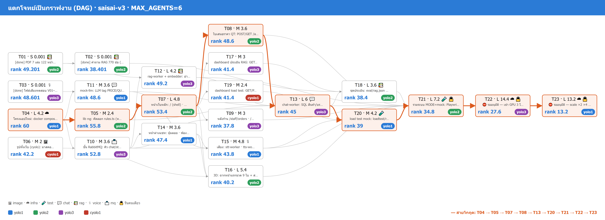
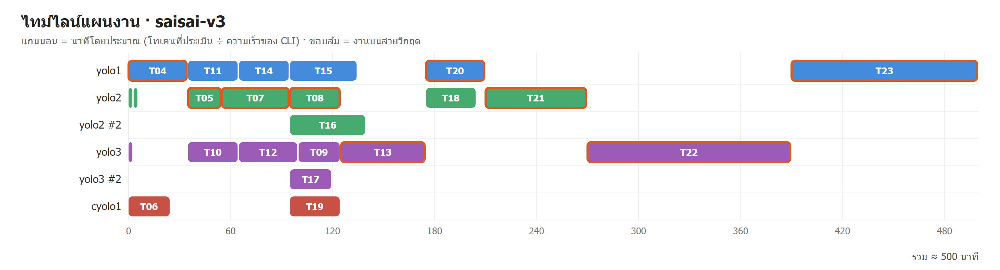

# PLAN · saisai-v3

**MAX_AGENTS:** 6 · **บัญชีที่ล็อกอิน:** 4 (yolo1, yolo2, yolo3, cyolo1) · **ตัวคุมวง (เหลือมากสุด):** `yolo1` · วางแผนเมื่อ 24/10/2026 21:48

> แผนนี้ **ยังไม่ได้รันจริง** — คำนวณด้วย KC-QUEST ตัวเดียวกับ LAB 04.2 แล้วจำลองเวลาตามลำดับ dependency

## 1) โควตาของแต่ละบัญชี

| บัญชี | แพลน | ใช้ไป 5 ชม. | ใช้ไปสัปดาห์ | เพดาน | เหลือ (headroom) | หมดอายุ/รีเซ็ต | เร่งด่วน U | คะแนน | slot |
|---|---|---|---|---|---|---|---|---|---|
| yolo1 | max | 0% | 0% | 100% | **100%** | 31/10 21:48 (168.0 ชม.) | 0.125 | 47.5 | 4 |
| yolo2 | max | 0% | 0% | 100% | **100%** | 31/10 21:48 (168.0 ชม.) | 0.125 | 47.5 | 4 |
| yolo3 | max | 0% | 0% | 100% | **100%** | 31/10 21:48 (168.0 ชม.) | 0.125 | 47.5 | 4 |
| cyolo1 | plus | 0% | 0% | 100% | **100%** | 31/10 21:48 (168.0 ชม.) | 0.125 | 47.5 | 3 |

## 2) กราฟงาน (DAG) + rank + บัญชีที่ได้งาน

**สายวิกฤต (critical path):** T04 → T05 → T07 → T08 → T13 → T20 → T21 → T22 → T23 · ยาว 60M tok

## 3) ตารางแจกงาน

| งาน | ชื่อ | ขนาด · c | ต้องรอ | rank | บัญชี | เริ่ม–จบ (นาที) | เหตุผล KC-QUEST |
|---|---|---|---|---|---|---|---|
| **T04** | โครงแอปใหม่: docker compose (web·db pgvector·rabbitmq·embedder·mock profile) + schema/seed 02-seed.sql + /api/test/reset | L · 4.2 | – | 60 | yolo1 | 0–35 | KC-QUEST 34.3 (urgency=0.125 fit=0.007 session=0.945 speed=1.0 load=0.0) · ประเมิน 4.20M tok ≈ 5ชม. 5.46% / สัปดาห์ 0.66% · อันดับ 2 yolo2 34.3 |
| T01 | [done] PDF 7 เล่ม 122 หน้า จาก data/facts/*.json | S · 0.001 | – | 49.201 | yolo2 | 0–3 | KC-QUEST 32.3 (urgency=0.125 fit=0.0 session=1.0 speed=0.82 load=0.0) · ประเมิน 0.00M tok ≈ 5ชม. 0.0% / สัปดาห์ 0.0% · อันดับ 2 yolo3 32.3 |
| T03 | [done] ไฟล์เสียงทดสอบ V01–V10 + questions/index.json | S · 0.001 | – | 48.601 | yolo3 | 0–3 | KC-QUEST 32.1 (urgency=0.125 fit=0.0 session=1.0 speed=0.81 load=0.0) · ประเมิน 0.00M tok ≈ 5ชม. 0.0% / สัปดาห์ 0.0% · อันดับ 2 yolo2 29.6 |
| T06 | รูปทั้งเว็บ (cyolo): มาสคอตน้องใส concept + 4 ท่า · banner-factory-3d · ขวด 9 รูป · PROMPTS.md | M · 2 | – | 42.2 | cyolo1 | 0–25 | KC-QUEST 26.7 (urgency=0.125 fit=0.007 session=0.948 speed=0.492 load=0.0) · ประเมิน 2.00M tok ≈ 5ชม. 5.2% / สัปดาห์ 0.65% |
| T02 | [done] คำถาม RAG 770 ข้อ (Gemini) + Qwen review 770/770 | S · 0.001 | T01 | 38.401 | yolo2 | 3–6 | KC-QUEST 29.6 (urgency=0.125 fit=0.0 session=1.0 speed=0.64 load=0.0) · ประเมิน 0.00M tok ≈ 5ชม. 0.0% / สัปดาห์ 0.0% · อันดับ 2 yolo3 29.6 |
| **T05** | lib กฎ: คัดลอก rules.ts (ห้ามแก้ตรรกะ) + POST /api/quote + unit test | M · 2.4 | T04 | 55.8 | yolo2 | 35–55 | KC-QUEST 33.6 (urgency=0.125 fit=0.004 session=0.969 speed=0.93 load=0.0) · ประเมิน 2.40M tok ≈ 5ชม. 3.12% / สัปดาห์ 0.37% · อันดับ 2 yolo3 33.6 |
| T10 | ชั้น RabbitMQ: คิว chat/stt/tts/rag · RPC chat.request→chat.reply · priority · DLQ · backpressure · SSE /api/chat | M · 3.6 | T04 | 52.8 | yolo3 | 35–65 | KC-QUEST 32.6 (urgency=0.125 fit=0.006 session=0.953 speed=0.88 load=0.0) · ประเมิน 3.60M tok ≈ 5ชม. 4.68% / สัปดาห์ 0.56% · อันดับ 2 yolo1 31.8 |
| T11 | mock-llm: LLM tag PRICE/QUOTE/ORDER_STATUS · หลายรอบ · ตัวเลขไทย · STT เทียบ fixture · TTS tts-cache · rerank ลำดับเดิม · MOCK_LATENCY_MS | M · 3.6 | T04, T03 | 48.6 | yolo1 | 35–65 | KC-QUEST 30.8 (urgency=0.125 fit=0.006 session=0.899 speed=0.81 load=0.0) · ประเมิน 3.60M tok ≈ 5ชม. 4.68% / สัปดาห์ 0.56% · อันดับ 2 yolo2 28.6 |
| **T07** | หน้าเว็บหลัก: / (shell) · /login · /products · /order · /orders · /orders/[no] · เคลม · /samples · TH/EN | L · 4.8 | T05 | 53.4 | yolo2 | 55–95 | KC-QUEST 32.1 (urgency=0.125 fit=0.008 session=0.906 speed=0.89 load=0.0) · ประเมิน 4.80M tok ≈ 5ชม. 6.24% / สัปดาห์ 0.75% · อันดับ 2 yolo3 29.4 |
| T12 | rag-worker + embedder: อ่าน PDF · chunk 500/80 + หัวตาราง · pgvector + pg_trgm · ingest 7 ไฟล์ตอนเริ่ม · /admin/docs อัปโหลด | L · 4.2 | T10, T01 | 49.2 | yolo3 | 65–100 | KC-QUEST 30.9 (urgency=0.125 fit=0.007 session=0.899 speed=0.82 load=0.0) · ประเมิน 4.20M tok ≈ 5ชม. 5.46% / สัปดาห์ 0.66% · อันดับ 2 yolo1 30.1 |
| T14 | หน้าต่างแชท: ปุ่มลอย · ฟอง · คำถามแนะนำ 3 · chat-cite (เปิด PDF หน้านั้น) · 🔊 tts-play / tts-auto คิวเล่นตาม seq | M · 3.6 | T10 | 47.4 | yolo1 | 65–95 | KC-QUEST 29.8 (urgency=0.125 fit=0.006 session=0.852 speed=0.79 load=0.0) · ประเมิน 3.60M tok ≈ 5ชม. 4.68% / สัปดาห์ 0.56% · อันดับ 2 yolo2 27.4 |
| **T08** | ใบเสนอราคา QT: POST/GET /api/quotes · /quotes/[no] · print CSS · หมดอายุ 7 วัน · แปลงเป็นออเดอร์ | M · 3.6 | T07 | 48.6 | yolo2 | 95–125 | KC-QUEST 30.2 (urgency=0.125 fit=0.006 session=0.86 speed=0.81 load=0.0) · ประเมิน 3.60M tok ≈ 5ชม. 4.68% / สัปดาห์ 0.56% · อันดับ 2 yolo1 29.3 |
| T15 | เสียง: stt-worker · tts-worker (cache sha256 · อ่านเงิน/รหัสเป็นคำ) · /api/voice · /api/voice/status · /api/tts · voice-mic · voice-mode · fake-mic.ts | M · 4.8 | T10, T11, T14 | 43.8 | yolo1 | 95–135 | KC-QUEST 27.9 (urgency=0.125 fit=0.008 session=0.789 speed=0.73 load=0.0) · ประเมิน 4.80M tok ≈ 5ชม. 6.24% / สัปดาห์ 0.75% · อันดับ 2 yolo3 26.2 |
| T17 | dashboard ประเมิน RAG: GET/POST /api/admin/eval · /admin/eval (การ์ด · กราฟต่อเล่ม · eval-by-doc on/off · compare · only=fail) | M · 3 | T07 | 41.4 | yolo3 | 95–120 | KC-QUEST 25.9 (urgency=0.125 fit=0.005 session=0.86 speed=0.69 load=0.25) · ประเมิน 3.00M tok ≈ 5ชม. 3.9% / สัปดาห์ 0.47% · อันดับ 2 cyolo1 25.5 |
| T19 | dashboard load test: GET/POST /api/admin/load · /admin/load (การ์ด N ต่อโหมด · กราฟ delay + เส้น 12 วิ + เส้นเป้า 200 · ขั้นไม่ผ่านสีแดง) | M · 2.4 | T07 | 41.4 | cyolo1 | 95–125 | KC-QUEST 25.7 (urgency=0.125 fit=0.008 session=0.886 speed=0.483 load=0.0) · ประเมิน 2.40M tok ≈ 5ชม. 6.24% / สัปดาห์ 0.78% · อันดับ 2 yolo2 25.4 |
| T16 | 3D: ฉากหน้าแรกขวด 9 ใบ + สายพาน · หมุนขวดในการ์ด · มาสคอต 3D 4 ท่า + ขยับปาก WebAudio · fallback ไม่มี WebGL | L · 5.4 | T06, T07, T14 | 40.2 | yolo2 | 95–140 | KC-QUEST 24.6 (urgency=0.125 fit=0.009 session=0.789 speed=0.67 load=0.25) · ประเมิน 5.40M tok ≈ 5ชม. 7.02% / สัปดาห์ 0.84% · อันดับ 2 yolo1 23.5 |
| T09 | หลังร้าน /staff/orders · /staff/claims · /owner/holidays + order.events → notify-worker + notify-box | M · 3 | T07, T10 | 37.8 | yolo3 | 100–125 | KC-QUEST 24.4 (urgency=0.125 fit=0.005 session=0.821 speed=0.63 load=0.25) · ประเมิน 3.00M tok ≈ 5ชม. 3.9% / สัปดาห์ 0.47% · อันดับ 2 yolo1 23.3 |
| **T13** | chat-worker: SQL สินค้า/บริษัท · Hybrid RAG (vector+trgm→RRF top20→rerank top4 · fallback) · tag → quote()/QT/สถานะ · ประวัติ 10 · privacy · ส่ง tts.request รายประโยค | L · 6 | T05, T08, T11, T12 | 45 | yolo3 | 125–175 | KC-QUEST 27.6 (urgency=0.125 fit=0.01 session=0.743 speed=0.75 load=0.0) · ประเมิน 6.00M tok ≈ 5ชม. 7.8% / สัปดาห์ 0.94% · อันดับ 2 yolo1 24.6 |
| **T20** | load test mock: loadtest/run_load.mjs 5 โหมด · อ่านคิว :15672 · รัน mix 1→250 (chat-worker ×2) · Q01 20 หน้าต่าง | M · 4.2 | T13, T15, T19 | 39 | yolo1 | 175–210 | KC-QUEST 25.9 (urgency=0.125 fit=0.007 session=0.735 speed=0.65 load=0.0) · ประเมิน 4.20M tok ≈ 5ชม. 5.46% / สัปดาห์ 0.66% · อันดับ 2 yolo2 25.9 |
| T18 | ชุดประเมิน: eval/rag.json (จาก 770 ข้อ) · qa.json 70–80 · conv 10–12 บท · run_eval.mjs · judgments · score.mjs · รัน mock rerank on/off | L · 3.6 | T02, T13, T17 | 38.4 | yolo2 | 175–205 | KC-QUEST 25.9 (urgency=0.125 fit=0.006 session=0.743 speed=0.64 load=0.0) · ประเมิน 3.60M tok ≈ 5ชม. 4.68% / สัปดาห์ 0.56% · อันดับ 2 yolo3 25.2 |
| **T21** | รวมระบบ MODE=mock: Playwright 62 เคสทั้งเพลย์ลิสต์ + GIF ทุกเคส + MP4 เคส T/V + unit rules.ts → TEST_REPORT.md (คอลัมน์ mock) | L · 7.2 | T08, T09, T12, T13, T15, T16, T18, T20 | 34.8 | yolo2 | 210–270 | KC-QUEST 23.7 (urgency=0.125 fit=0.012 session=0.649 speed=0.58 load=0.0) · ประเมิน 7.20M tok ≈ 5ชม. 9.36% / สัปดาห์ 1.12% · อันดับ 2 yolo3 23.7 |
| **T22** | ⛔ รออนุมัติ — เช่า GPU 3 ใบ (5090 Qwen · 4090 Whisper · 4090 VoxCPM2+rerank) · MODE=ai: 62 เคส · eval ai on/off · load (ข) ต่อ GPU + (ค) คำนวณ 200 คน · destroy | L · 14.4 | T21 | 27.6 | yolo3 | 270–390 | KC-QUEST 20.7 (urgency=0.125 fit=0.023 session=0.555 speed=0.46 load=0.0) · ประเมิน 14.40M tok ≈ 5ชม. 18.72% / สัปดาห์ 2.25% · อันดับ 2 yolo1 20.6 |
| **T23** | ⛔ รออนุมัติ — scale ×2 ×4 (9.x · LLM 2 และ 4 ใบ) + SALE_RUN.md ฉบับจบ · destroy | L · 13.2 | T22 | 13.2 | yolo1 | 390–500 | KC-QUEST 17.2 (urgency=0.125 fit=0.021 session=0.563 speed=0.22 load=0.0) · ประเมิน 13.20M tok ≈ 5ชม. 17.16% / สัปดาห์ 2.06% · อันดับ 2 cyolo1 16.3 |

## 4) ไทม์ไลน์ (ใครทำงานไหน เมื่อไร)

## 5) รอบแจกงาน

| นาทีที่ | งานที่เริ่ม |
|---|---|
| 0 | T06→cyolo1, T04→yolo1, T01→yolo2, T03→yolo3 |
| 3 | T02→yolo2 |
| 35 | T05→yolo2, T10→yolo3, T11→yolo1 |
| 55 | T07→yolo2 |
| 65 | T12→yolo3, T14→yolo1 |
| 95 | T08→yolo2, T15→yolo1, T17→yolo3, T19→cyolo1, T16→yolo2 |
| 100 | T09→yolo3 |
| 125 | T13→yolo3 |
| 175 | T20→yolo1, T18→yolo2 |
| 210 | T21→yolo2 |
| 270 | T22→yolo3 |
| 390 | T23→yolo1 |

## 6) สรุป

- งานทั้งหมด 23 · แจกได้ 23 · ไม่มีใครรับ 0
- worker พร้อมกันสูงสุด **6** (เพดาน 6 · งานรูปของ cyolo ไม่นับ)
- เวลาประมาณ **500 นาที** (ถ้าทำทีละงานด้วยบัญชีเดียว ≈ 827 นาที → เร็วขึ้น ~1.7 เท่า)
- `cyolo1` ได้ 2 งาน: T06, T19
- `yolo1` ได้ 6 งาน: T04, T11, T14, T15, T20, T23
- `yolo2` ได้ 8 งาน: T01, T02, T05, T07, T08, T16, T18, T21
- `yolo3` ได้ 7 งาน: T03, T10, T12, T17, T09, T13, T22
